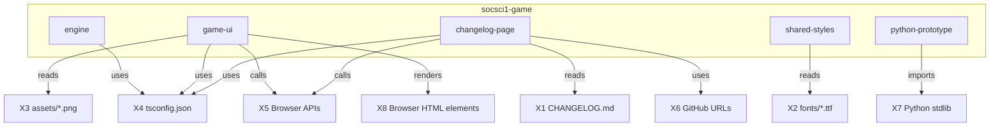
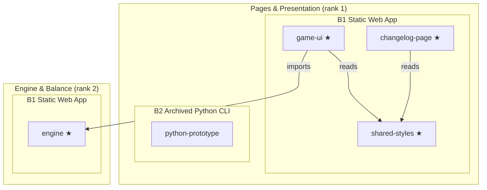

# socsci1-game codemap

Built from audit `2026-11-16-bb9df24` at commit `bb9df24`. To check freshness:
`git diff --name-only bb9df24..HEAD`

> For runtime lifecycle diagrams, game formulas, data models, and build/test recipes, see [DEV_GUIDE.md](DEV_GUIDE.md). For UI component specs, variants, states, and raw values, see [COMPONENTS.md](COMPONENTS.md) and [DESIGN_SYSTEM.md](DESIGN_SYSTEM.md).

## L0 System

**socsci1-game**: Metro Manila commuting game web app (HTML/CSS/TypeScript) with an archived Python CLI prototype. Entry: `index.html:1` (also `changelog.html:1`, `python/main.py:19`).

| Outside | Kind | Used by | Type | Evidence | Confidence |
|---|---|---|---|---|---|
| `X1` CHANGELOG.md | file | `changelog-page` | `reads` | `src/changelog.ts:246` | CONFIRMED |
| `X2` fonts/PressStart2P-Regular.ttf & fonts/VT323-Regular.ttf | file | `shared-styles` | `reads` | `base.css:3-13` | CONFIRMED |
| `X3` assets/*.png (unpopulated optional art directory) | file | `game-ui` | `reads` | `src/ui-stage.ts:85` | CONFIRMED |
| `X4` tsconfig.json (TypeScript ES2020 build to js/) | config | `engine`, `game-ui`, `changelog-page` | `uses` | `tsconfig.json:8-9` | CONFIRMED |
| `X5` Browser DOM, Fetch, URLSearchParams, performance.now APIs | tool | `game-ui`, `changelog-page` | `calls` | `src/ui.ts:6-7` | CONFIRMED |
| `X6` GitHub compare/tree URLs (github.com/Dev-020/socsci1-game) | service | `changelog-page` | `uses` | `src/changelog.ts:144-159` | CONFIRMED |
| `X7` Python standard library (os, sys, copy, random, math, dataclasses, typing) | library | `python-prototype` | `imports` | `python/main.py:6` | CONFIRMED |
| `X8` Browser HTML elements (button, a, h1-h3, p, …) | tool | `game-ui` | `renders` | `src/ui-stage.ts:459` | CONFIRMED |

## L1 Subsystems

| Layer | Unit | Purpose | Marks |
|---|---|---|---|
| Pages & Presentation (rank 1) | `game-ui` | Main game page, UI router, stage and plain screen controllers, screen text and seed helpers, theme contracts, and game styles | ★ 0/2, ⧉ B1 |
| Pages & Presentation (rank 1) | `changelog-page` | Standalone changelog page that fetches and renders CHANGELOG.md | ★ 0/1, ⧉ B1 |
| Pages & Presentation (rank 1) | `shared-styles` | Shared @font-face rules and :root color and font tokens loaded by every page | ★ 2/0, ⧉ B1 |
| Pages & Presentation (rank 1) | `python-prototype` | Archived CLI commuter simulation prototype | ⧉ B2 |
| Engine & Balance (rank 2) | `engine` | Game rules, balance data and the deterministic seeded roll (src/game.ts, src/data.ts) | ★ 1/0, ⧉ B1 |

| From | To | Types | Count | Evidence | Confidence | Marks |
|---|---|---|---|---|---|---|
| `game-ui` | `engine` | `imports` | 5 | `src/ui-stage.ts:5` | CONFIRMED | |
| `game-ui` | `shared-styles` | `reads` | 1 | `index.html:8` | CONFIRMED | |
| `changelog-page` | `shared-styles` | `reads` | 1 | `changelog.html:8` | CONFIRMED | |

**Boundaries:**

| Id | Kind | Name | Units | Evidence |
|---|---|---|---|---|
| `B1` | deployable | Static Web App (GitHub Pages / local HTTP server) | `game-ui`, `changelog-page`, `engine`, `shared-styles` | `index.html:1, changelog.html:1, tsconfig.json:8-9` |
| `B2` | process | Archived Python CLI Prototype | `python-prototype` | `python/main.py:19-20` |

## L2 Modules

No module units in the record.

## L3 Files

| Unit | Parent | Purpose | Marks |
|---|---|---|---|
| `src/data.ts` | `engine` | Static game balance values, constants, character presets, transit options, weather, and events | ★ 4/0 |
| `src/game.ts` | `engine` | Pure Game engine class, Taylor-series seededRoll, fare/drain math, offer filtering, the 3-of-the-available offer draw (one roll, purpose 7, over every set; Walk added last when none is affordable), and 1-turn undo | ★ 2/1 |
| `index.html` | `game-ui` | Root HTML document hosting #app and loading base.css, stage.css, and compiled js/ui.js | ★ 0/3 |
| `src/ui.ts` | `game-ui` | Game page entry router switching between stage UI and ?ui=plain wireframe UI | ★ 1/3 |
| `src/ui-stage.ts` | `game-ui` | Arcade cabinet stage controller managing 6 in-page screens, animations, swipe loop, and theme binding | ★ 1/4 |
| `src/ui-plain.ts` | `game-ui` | Minimal wireframe UI controller for ?ui=plain rules testing | ★ 1/3 |
| `src/format.ts` | `game-ui` | URL seed parsing, entropySeed generator, peso/signed formatters, and event effect formatter | ★ 2/1 |
| `src/theme.ts` | `game-ui` | CharacterTheme contracts, DEFAULT_THEME, and per-character theme lookup | |
| `stage.css` | `game-ui` | 16:9 arcade stage layout, --px scaling, animations, portrait swipe carousel, and theme overrides | |
| `style.css` | `game-ui` | Minimal light/dark stylesheet for ?ui=plain mode | |
| `base.css` | `shared-styles` | Shared @font-face declarations and :root color/font tokens used across HTML pages | ★ 2/0 |
| `changelog.html` | `changelog-page` | Standalone scrolling changelog HTML document loading base.css, changelog.css, and compiled js/changelog.js | ★ 0/3 |
| `src/changelog.ts` | `changelog-page` | Fetches CHANGELOG.md, parses Keep a Changelog markdown, and builds DOM cards safely | |
| `changelog.css` | `changelog-page` | Responsive scrolling document styles, version cards, category tags, and collapsible Unreleased section | |
| `python/main.py` | `python-prototype` | CLI entry point starting GameEngine | |
| `python/engine.py` | `python-prototype` | Python CLI game loop, option selection, event rolls, and win/loss checks | |
| `python/models.py` | `python-prototype` | Python dataclasses and default balance constants for the CLI prototype | |

| From | To | Types | Count | Evidence | Confidence | Marks |
|---|---|---|---|---|---|---|
| `index.html` | `base.css` | `reads` | 1 | `index.html:8` | CONFIRMED | |
| `index.html` | `stage.css` | `reads` | 1 | `index.html:9` | CONFIRMED | |
| `index.html` | `src/ui.ts` | `calls` | 1 | `index.html:13` | CONFIRMED | |
| `src/ui.ts` | `src/ui-plain.ts` | `imports`, `renders` | 2 | `src/ui.ts:3` | CONFIRMED | |
| `src/ui.ts` | `src/ui-stage.ts` | `imports`, `renders` | 2 | `src/ui.ts:4` | CONFIRMED | |
| `src/ui.ts` | `style.css` | `configures` | 1 | `src/ui.ts:9` | CONFIRMED | |
| `src/ui-stage.ts` | `src/data.ts` | `imports` | 1 | `src/ui-stage.ts:5` | CONFIRMED | |
| `src/ui-stage.ts` | `src/game.ts` | `imports` | 1 | `src/ui-stage.ts:7` | CONFIRMED | |
| `src/ui-stage.ts` | `src/format.ts` | `imports` | 1 | `src/ui-stage.ts:9` | CONFIRMED | |
| `src/ui-stage.ts` | `src/theme.ts` | `imports` | 1 | `src/ui-stage.ts:10` | CONFIRMED | |
| `src/ui-plain.ts` | `src/data.ts` | `imports` | 1 | `src/ui-plain.ts:3` | CONFIRMED | |
| `src/ui-plain.ts` | `src/game.ts` | `imports` | 1 | `src/ui-plain.ts:4` | CONFIRMED | |
| `src/ui-plain.ts` | `src/format.ts` | `imports` | 1 | `src/ui-plain.ts:6` | CONFIRMED | |
| `src/game.ts` | `src/data.ts` | `imports` | 1 | `src/game.ts:4-15` | CONFIRMED | |
| `src/format.ts` | `src/data.ts` | `imports` | 1 | `src/format.ts:3-4` | CONFIRMED | |
| `changelog.html` | `base.css` | `reads` | 1 | `changelog.html:8` | CONFIRMED | |
| `changelog.html` | `changelog.css` | `reads` | 1 | `changelog.html:9` | CONFIRMED | |
| `changelog.html` | `src/changelog.ts` | `calls` | 1 | `changelog.html:26` | CONFIRMED | |
| `python/main.py` | `python/engine.py` | `imports` | 1 | `python/main.py:7` | CONFIRMED | |
| `python/engine.py` | `python/models.py` | `imports` | 1 | `python/engine.py:12-21` | CONFIRMED | |

## L4 Symbols

Omitted (map depth is `file`; 58 UI `symbol` units live in `core.md` and `docs/components.json`).

## Not shown

- **G1 (`js/`):** Compiled ES module output emitted by `tsc` from `src/`; excluded to avoid duplicating `src/` units (`index.html:13` and `changelog.html:26` map directly to `src/ui.ts` and `src/changelog.ts`).
- **G2 (`index.html <-> changelog.html hyperlinks`):** HTML `<a href>` navigation links (`src/ui-stage.ts:460`, `src/ui-plain.ts:55`, `changelog.html:14`) are page navigation, not code imports/calls; omitted from dependency edges so cycle checks reflect module/style coupling accurately.
- **G3 (`module level`):** The codebase uses flat `src/` and `python/` directories with no `module` units; central-unit and cycle counts ran at `subsystem` and `file` levels only.
- **G4 (`src/ui-stage.ts` inline style mutations):** Runtime percentage widths and scroll offsets (`src/ui-stage.ts:308-353,390-399`) are not tokenizable CSS values.
- **G5 (`assets/*.png` artwork):** `assets/` contains no PNG files yet; placeholder labels render instead.
- **G6 (`index.html`, `changelog.html` inline attributes):** No inline `style=""` attributes exist (`index.html:1-14`, `changelog.html:1-28`).
- **G7 (`non-token layout/keyword/angle literals`):** Structural CSS keywords (`0`, `none`, `auto`, `inherit`, `50%`, `100%`, `transparent`, `90deg`) and proportions (`16 / 9`, `flex: 1`) are excluded per `protocol/audit-lens-ui`.
- **L2 Modules** and **L4 Symbols** (beyond `file` depth).
