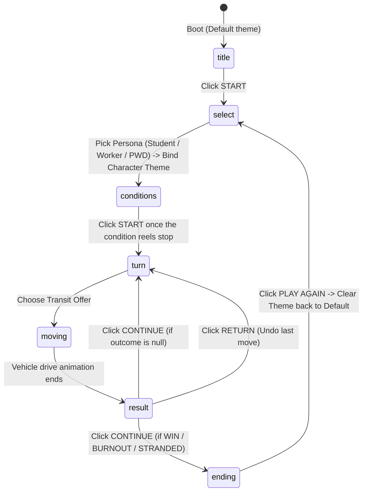
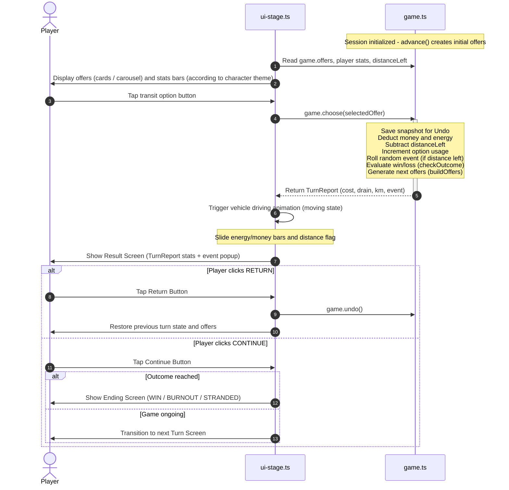

# Commuter Game: Developer Guide

Runtime lifecycle diagrams, game rules reference, core data models, quick-lookup recipes, and build/release workflow for the **Metro Manila Commuting Game** (SOCSCI1 Capstone).

For the audit-backed structural map of subsystems, files, and dependencies, see [docs/CODEMAP.md](CODEMAP.md).

---

## 1. Core Separation of Concerns

The project adheres to a strict division of responsibilities:

1. **Pages and Screens Architecture ([`docs/conventions/pages-and-screens.md`](conventions/pages-and-screens.md)):**
   - Distinct documents (`index.html`, `changelog.html`) represent standalone pages with their own URLs and layouts.
   - In-page states (`title`, `select`, `turn`, `moving`, `result`, `ending`) are screens swapped in place by the page controller.
   - Pages share visual tokens (`base.css`), not unnecessary runtime abstractions.

2. **Game Engine ([`src/game.ts`](../src/game.ts)):**
   - Pure TypeScript with zero DOM/browser dependencies.
   - Manages all calculations: resource deductions, random rolls, distance capping, event probabilities, and win/loss states.
   - Fully deterministic through a custom Taylor-series seeded RNG (`seededRoll`).
   - Supports 1-turn undo via `TurnSnapshot`.

3. **Data & Balance ([`src/data.ts`](../src/data.ts)):**
   - Contains all numerical constants, persona definitions, transit mode stats, starting conditions (`CONDITIONS`, weather included), and event tables.
   - Modifying game balance only touches this file; changing values here does not require code refactoring.

4. **Themes & Design System ([`src/theme.ts`](../src/theme.ts) & [`docs/DESIGN_SYSTEM.md`](DESIGN_SYSTEM.md)):**
   - Defines character visual profiles, meter rendering styles (`segmented` vs `continuous`), and accent palettes.
   - Follows a template pattern where new characters copy from `DEFAULT_THEME`.

5. **Presentation ([`src/ui-stage.ts`](../src/ui-stage.ts), [`src/changelog.ts`](../src/changelog.ts)):**
   - Renders interactive screens and binds user input.
   - Changelog DOM is assembled safely via `textContent` and node building without `innerHTML`.
   - Does **not** compute game rules or balance math.

---

## 2. Game Lifecycle & The Turn Flow

### 2.1 Stage Screen State Machine
The stage UI is governed by a state machine tracking the active screen:



### 2.2 Lifecycle of a Single Turn
Every commuter turn follows an explicit data exchange between the UI and Engine:



---

## 3. Calculations & Rules Reference

| Logic | Function | Location | Implementation Details |
|---|---|---|---|
| **Fare Cost** | `fare()` | [`src/game.ts:113`](../src/game.ts#L113) | - **Motorcycle:** ₱50 (1st km), +₱10/km (up to 10th km), +₱20/km thereafter.<br/>- **Car:** ₱60 (1st km), +₱15/km thereafter.<br/>- **Others:** Flat fare (`costDiscount` or `costRegular` based on persona). |
| **Starting Conditions** | `Game` constructor, `combinations()` | [`src/game.ts:96`](../src/game.ts#L96) | One seeded roll (purpose 1, turn 1) picks one of the 675 combinations of `CONDITIONS` (weather first, so each seed keeps its weather). Start values: `money = max(0, base + Σ money)`, `maxEnergy = max(1, base + Σ maxEnergy)`, energy starts full. Removed rides are gone for the whole run. |
| **Energy Drain** | `energyDrain()` | [`src/game.ts:132`](../src/game.ts#L132) | `Math.trunc(baseDrain × (100 + Σ drainPercent) / 100) + pwdPenalty + Σ drainFlat`, never below 0. Percentages add, and only conditions whose `appliesTo` includes the ride count (`ridesInclude()`, [`src/game.ts:106`](../src/game.ts#L106)). PWD receives +8 drain on `walk` and `jeep`. |
| **Deterministic RNG** | `seededRoll()` | [`src/game.ts:64`](../src/game.ts#L64) | Taylor-series sine hash based on `seed`, `turn`, and `purpose` ID. Guarantees cross-browser identical rolls. |
| **Offer Filtering** | `availableOptions()` | [`src/game.ts:265`](../src/game.ts#L265) | Filters options based on: distance remaining (e.g. Train > 6km, Car > 2km, Tricycle ≤ 4km), rides removed by the starting conditions (e.g. no Motor in Rain), usage limits, and event mode blocks. |
| **Win/Loss Check** | `checkOutcome()` | [`src/game.ts:333`](../src/game.ts#L333) | - `WIN`: `distanceLeft <= 0`<br/>- `BURNOUT`: `player.energy <= 0`<br/>- `STRANDED`: Cannot afford cheapest ride and lack energy to walk the remaining distance. |

---

## 4. Core Data Models

Defined in [`src/data.ts`](../src/data.ts), [`src/theme.ts`](../src/theme.ts), and [`src/game.ts`](../src/game.ts):

- **`Character`**: Persona configuration (`money`, `maxEnergy`, `energy`, `discount`, `pwdPenalty`).
- **`CharacterTheme`**: Persona visual and layout profile (`id`, `name`, `energyBarStyle`, `moneyDisplayStyle`, `badgeLabel`, `accentPalette`).
- **`TransitOption`**: Transit profile (`key`, `name`, `distanceKm`, `energyDrain`, `costDiscount`, `costRegular`, `maxUses`).
- **`Offer`**: Specific choice presented to player for that turn (`option`, `km`, `cost`, `drain`, `affordable`, `usesLeft`).
- **`TurnReport`**: Outcome summary returned by `choose()` (`optionName`, `km`, `cost`, `drain`, `event`).
- **`RandomEvent`**: Event trigger definition (`name`, `description`, `energyMod`, `moneyMod`, `distanceMod`, `applicableModes`, `disabledModes`).
- **`ConditionCategory`** / **`ConditionOption`**: A starting-condition category (`key`, `name`, `studentName?`, `options`) and one option (`key`, `name`, `description`, `money?`, `maxEnergy?`, `drainPercent?`, `drainFlat?`, `appliesTo?`, `removes?`). Weather is the first category.
- **`PickedCondition`**: One rolled condition for a run (`category`, `option`), listed in `game.conditions`; `game.weather` is the first one's option.
- **`RideList`**: A list of ride keys; empty or missing means every ride. Used by `appliesTo`, `removes` and the events' ride lists.

---

## 5. Developer Quick-Lookup Recipe

| When you want to... | Look at file | Search for / inspect |
|---|---|---|
| **Add or edit transit vehicle stats** (costs, energy, max uses) | [`src/data.ts`](../src/data.ts) | `export const TRANSIT` |
| **Change character starting money or energy** | [`src/data.ts`](../src/data.ts) | `export const CHARACTERS` |
| **Add or edit starting conditions** (weather included) | [`src/data.ts`](../src/data.ts) | `export const CONDITIONS` |
| **Add or replace art** (conditions, characters, rides, events, scenes) | [`docs/design-system/asset-slots.md`](design-system/asset-slots.md) | The folder map and the slot table |
| **Add or edit character themes, meter styles & palettes** | [`src/theme.ts`](../src/theme.ts) & [`stage.css`](../stage.css) | `export const CHARACTER_THEMES`, `.stage[data-character="..."]` |
| **Inspect design tokens, typography, and component blueprints** | [`docs/DESIGN_SYSTEM.md`](DESIGN_SYSTEM.md) | Whole document |
| **Review pages vs screens rules for adding new content** | [`docs/conventions/pages-and-screens.md`](conventions/pages-and-screens.md) | Whole document |
| **Report a bug or suggest a change** | [GitHub Issues](https://github.com/Dev-020/socsci1-game/issues) | Open a new issue |
| **Add or tune random events** | [`src/data.ts`](../src/data.ts) | `export const EVENTS` |
| **Change event trigger probability or distance goal** | [`src/data.ts`](../src/data.ts) | `EVENT_PROBABILITY`, `TOTAL_DISTANCE_KM` |
| **Adjust fare formulas or PWD penalties** | [`src/game.ts`](../src/game.ts) | `function fare()`, `function energyDrain()` |
| **Change transit option availability rules** | [`src/game.ts`](../src/game.ts) | `private availableOptions()` |
| **Tune vehicle drive animation duration** | [`src/ui-stage.ts`](../src/ui-stage.ts) & [`stage.css`](../stage.css) | `MOVE_TIMEOUT_MS`, `.vehicle.moving` |
| **Modify mobile swipe carousel behavior** | [`src/ui-stage.ts`](../src/ui-stage.ts) | `setupOptionLoop()`, `PORTRAIT_PHONE` |
| **Update speech bubble text** | [`src/ui-stage.ts`](../src/ui-stage.ts) | `const SPEECH` |
| **Modify colors, pixel fonts, or card layouts** | [`base.css`](../base.css) & [`stage.css`](../stage.css) | Root CSS variables, `.stage[data-character="..."]`, `.stage-screen` |

---

## 6. Build, Test & Release Workflow

### TypeScript Compilation
The compiled JavaScript is kept in `js/` because GitHub Pages serves the repository statically.
```bash
npx -p typescript tsc
```

### Local Development Server
The game uses native ES modules (`import`/`export`), which browser security prohibits loading via `file://`. Test via a local HTTP server:
```bash
python -m http.server
```
Visit:
- Arcade Stage UI: `http://localhost:8000`
- Plain Debug UI: `http://localhost:8000/?ui=plain`
- Changelog: `http://localhost:8000/changelog.html`
- Custom RNG Seed: `http://localhost:8000/?seed=12345`

### Release & Deployment Policy
- Pushes to the `master` branch immediately publish to the live site at `https://dev-020.github.io/socsci1-game/`.
- Only push when explicitly requested by the user.
- Version bumps follow [`docs/conventions/versioning.md`](conventions/versioning.md) and are recorded in [`CHANGELOG.md`](../CHANGELOG.md).
